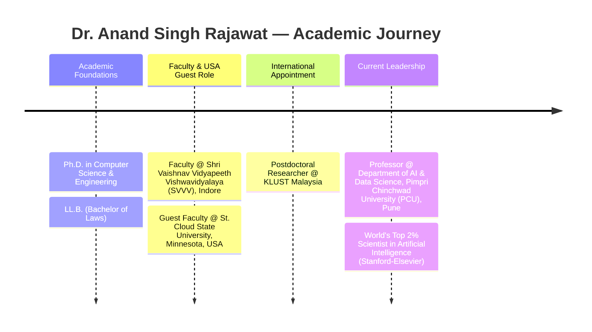

<div align="center">

<!-- ========================================================================= -->
<!-- HERO BANNER - ANIMATED DYNAMIC CAPSULE RENDER (CYBER / QUANTUM AI THEME)  -->
<!-- ========================================================================= -->
<a href="https://orcid.org/0000-0001-5940-5799">
  
</a>

<br/>

<!-- ========================================================================= -->
<!-- TYPING SVG ANIMATION - ROTATING RESEARCH AND LEADERSHIP HIGHLIGHTS       -->
<!-- ========================================================================= -->
<a href="#-research-domains--specializations">
  
</a>

<br/><br/>

<!-- ========================================================================= -->
<!-- STATUS BADGES & AFFILIATION PILLS                                        -->
<!-- ========================================================================= -->
<p align="center">
  <a href="https://pcu.edu.in" target="_blank">
    
  </a>
  <a href="https://orcid.org/0000-0001-5940-5799" target="_blank">
    
  </a>
  
  
</p>

<!-- ========================================================================= -->
<!-- TOP RECOGNITION BANNER                                                   -->
<!-- ========================================================================= -->
<p align="center">
  <a href="https://orcid.org/0000-0001-5940-5799" target="_blank">
    
  </a>
</p>

</div>

---

### 👨‍🏫 Executive Biography & Academic Leadership

> *"Bridging foundational artificial intelligence, post-quantum cryptographic security, and real-world software engineering to create resilient, ethical, and scalable technological ecosystems."*

**Dr. Anand Singh Rajawat** is a distinguished AI Scientist, Professor, and Technology Innovator with over **17+ years of experience** spanning higher education, cutting-edge scientific research, software architecture, and academic leadership. He serves as **Professor in the Department of Artificial Intelligence and Data Science** at **Pimpri Chinchwad University (PCU)** in Pune, Maharashtra, India, and holds an international appointment as **Postdoctoral Researcher at KLUST Malaysia**.

Holding a **Ph.D. in Computer Science and Engineering** alongside a **Bachelor of Laws (LL.B.)**, Dr. Rajawat brings an exceptionally rare interdisciplinary perspective to computer science—unifying algorithmic rigor, machine learning architecture, distributed ledger integrity, and legal/regulatory compliance for **AI Governance and Law-Tech**.

His career includes prestigious global and national appointments, notably serving as **Former Guest Faculty at St. Cloud State University, USA**, and **Former Faculty at Shri Vaishnav Vidyapeeth Vishwavidyalaya (SVVV), Indore**. Recognized globally among the **World's Top 2% Scientists in Artificial Intelligence** (Stanford University–Elsevier, 2026), he leads high-impact scientific investigations at the confluence of foundational AI, federated privacy-preserving systems, quantum technologies, healthcare cyber-physical architectures, and intelligent workflow automation.

<br/>

```python
# Dr. Anand Singh Rajawat — Profile Architecture
class AcademicProfile:
    def __init__(self):
        self.name = "Dr. Anand Singh Rajawat"
        self.title = "Professor & Senior AI Research Scientist"
        self.degrees = ["Ph.D. (Computer Science & Engineering)", "LL.B. (Law)"]
        self.affiliation = "Pimpri Chinchwad University (PCU), Pune, India"
        self.postdoc = "KLUST Malaysia"
        self.former_appointments = [
            "Guest Faculty, St. Cloud State University, USA",
            "Faculty, Shri Vaishnav Vidyapeeth Vishwavidyalaya (SVVV), Indore"
        ]
        self.global_recognition = "World's Top 2% Scientists — Artificial Intelligence"
        self.core_mission = [
            "Foundational & Applied AI/ML Systems",
            "Decentralized Infrastructure & Quantum-Resilient Security",
            "Privacy-Preserving Federated Healthcare Diagnostics (IoMT)",
            "AI Governance, Legal Ethics & Enterprise Automation"
        ]

    def get_status(self):
        return "Actively driving doctoral research, international grants, and AI-industry solutions."
```

---

### 📊 Research Impact & Scientific Metrics

<div align="center">

| Metric | Scientific Output | Focus / Domain | Primary Verification |
| :--- | :---: | :--- | :---: |
| 📚 **Total Publications** | **`257+`** | Peer-reviewed journals, book chapters & conferences | [Scopus Author Profile](https://www.scopus.com/authid/detail.uri?authorId=60106472500) |
| 📈 **Citations** | **`3,000+`** | Global academic & industrial citations | [ORCID Identifier](https://orcid.org/0000-0001-5940-5799) |
| 🔬 **h-index** | **`36`** | High-impact cumulative research citation factor | Published Literature |
| 📑 **i10-index** | **`82`** | Research papers with ≥ 10 citations | Scholarly Indexing |
| 💡 **Patents Filed / Granted** | **`12+`** | Technological innovations, IoT & security systems | Patent Authorities |
| 📖 **Books Published / Edited** | **`10+`** | AI, Blockchain, Deep Learning & IoT systems | Global Academic Presses |
| 🏆 **World Standing** | **Top 2%** | Artificial Intelligence (Stanford–Elsevier, 2026) | Stanford–Elsevier Ranking |

<br/>

<!-- Metric Cards Visual Badges -->

&nbsp;

&nbsp;

&nbsp;

&nbsp;

&nbsp;


<br/><br/>

> <sub>*Note: Research metrics are reported from authoritative academic profile documentation and represent verified cumulative figures.*</sub>

</div>

#### 🏛️ Leading Publishing Organizations & Academic Presses

Dr. Rajawat’s scholarship and editorial contributions are widely published across the world’s preeminent peer-reviewed presses:

<div align="center">


&nbsp;

&nbsp;

&nbsp;

<br/>

&nbsp;

&nbsp;

&nbsp;


</div>

---

### 🔬 Research Domains & Specializations

The research portfolio of Dr. Anand Singh Rajawat converges across five structured, interdisciplinary scientific pillars:

<table>
<tr>
<td width="50%" valign="top">

#### 🧠 1. Intelligent Systems & Learning
* **Artificial Intelligence & Deep Learning**: Advanced neural architectures, predictive modeling, and representation learning.
* **Federated Learning**: Decentralized, privacy-preserving model training across edge and distributed network nodes.
* **Large Language Models & Prompt Engineering**: Fine-tuning, prompt optimization, and enterprise LLM pipeline orchestration.


</td>
<td width="50%" valign="top">

#### ⚛️ 2. Quantum Computing & Cybersecurity
* **Quantum Computing & Quantum AI**: Quantum circuit development, hybrid quantum-classical algorithms, and quantum optimization.
* **Post-Quantum Cryptography (PQC)**: Cryptographic resilience against quantum computational attacks for secure data exchange.
* **Cyber Security**: Robust intrusion detection, zero-trust infrastructure, and cyber-threat defense.


</td>
</tr>

<tr>
<td width="50%" valign="top">

#### ⛓️ 3. Blockchain & Decentralized Infrastructure
* **Blockchain Security**: Consensus protocols, formal verification, and vulnerability analysis in smart contracts.
* **Decentralized Systems & P2P Networks**: Tokenomics, peer-to-peer renewable energy trading, and trustless architectures.
* **Smart Contract Engineering**: Autonomous transactional logic via Solidity and EVM-compatible networks.


</td>
<td width="50%" valign="top">

#### 🏥 4. Healthcare AI & Cyber-Physical Systems
* **Healthcare AI & IoMT**: Clinical diagnosis algorithms, Internet of Medical Things, and patient monitoring.
* **Wireless Body Area Networks (WBAN)**: Low-power bio-sensor network optimization and secure physiological telemetry.
* **Cyber-Physical Systems (CPS)**: Real-time sensor-actuator feedback loops in industrial and urban infrastructure.


</td>
</tr>

<tr>
<td colspan="2" valign="top">

#### ⚖️ 5. Cloud, Big Data & AI Governance / Law-Tech
* **Big Data & Cloud Computing**: Scalable data pipelines, distributed processing, and robust virtualized cloud systems.
* **AI Governance & Ethical AI**: Algorithmic transparency, fairness audits, compliance frameworks, and AI policy.
* **Law-Tech Synergy**: Leveraging dual CS (Ph.D.) and Law (LL.B.) expertise to architect legally defensible, regulatory-compliant AI software.


</td>
</tr>
</table>

---

### 🌐 Research Funding & International Grants

Dr. Rajawat has actively served as **Principal Investigator (PI)** and **Co-Principal Investigator (Co-PI)** on prestigious research projects sponsored by prominent national and international funding bodies:

<div align="center">

| Funding Body | Jurisdiction | Sponsorship Role | Strategic Research Scope |
| :--- | :---: | :---: | :--- |
| **Department of Science & Technology (DST)** | 🇮🇳 India | **PI / Co-PI** | National S&T initiatives, IoT, and intelligent computational systems |
| **European Union Horizon 2020 (EU H2020)** | 🇪🇺 European Union | **PI / Co-PI** | Transnational AI, secure data processing, and collaborative innovation |
| **UEFISCDI** | 🇷🇴 Romania | **PI / Co-PI** | Advanced bilateral scientific research and international knowledge exchange |
| **National Natural Science Foundation of China (NSFC)** | 🇨🇳 China | **PI / Co-PI** | Foundational science, advanced computing, and intelligent networks |

<br/>


&nbsp;

&nbsp;

&nbsp;


</div>

> 🤝 **Open to Global Research Alliances**: Dr. Rajawat welcomes collaborative partnerships for multi-institutional grant proposals, doctoral thesis advisement, joint international journal special issues, and applied R&D consortiums.

---

### 🛠️ Technical Ecosystem & Engineering Stack

Dr. Rajawat combines deep academic research with hands-on software development and systems engineering:

<div align="center">

#### 💻 Visual Tooling Suite
<a href="#-technical-ecosystem--engineering-stack">
  
</a>

<br/><br/>

</div>

| Category | Core Technologies & Frameworks | Implementation Focus |
| :--- | :--- | :--- |
| **Programming & Data** |    | Scientific computing, algorithmic modeling, and relational database management |
| **AI & Deep Learning** |     | Deep neural networks, LLM fine-tuning, RAG pipelines, and automated reasoning |
| **Software & Web** |  | Robust backend APIs, scalable MVC architecture, and secure enterprise web portals |
| **Automation & Agentic** |   | Low-code orchestration, event-driven webhooks, and agentic workflow automation |
| **Blockchain & Quantum** |    | EVM smart contracts, decentralized consensus, and IBM Qiskit quantum computing |
| **Cloud & Infrastructure**|   | Containerized environments, microservice isolation, and Linux VPS infrastructure |

---

### 🏛️ Academic Appointments & Journey



* 🎓 **Current Academic Chair**: Professor, Department of Artificial Intelligence and Data Science, **Pimpri Chinchwad University (PCU)**, Pune, Maharashtra, India
* 🔬 **Postdoctoral Research Appointment**: Postdoctoral Researcher, **KLUST Malaysia**
* 🌐 **International Academic Appointment**: Former Guest Faculty, **St. Cloud State University**, Minnesota, USA
* 🏛️ **Prior University Faculty Appointment**: Former Faculty, **Shri Vaishnav Vidyapeeth Vishwavidyalaya (SVVV)**, Indore, Madhya Pradesh, India
* 📜 **Educational Qualifications**:
  * **Ph.D.** in Computer Science and Engineering
  * **LL.B.** (Bachelor of Laws)

---

### 💻 GitHub Analytics & Open Source Activity

<div align="center">

<!-- GitHub Readme Stats & Streak Stats -->
<table border="0">
  <tr>
    <td align="center" valign="middle">
      <a href="https://github.com/anandrajawat">
        
      </a>
    </td>
    <td align="center" valign="middle">
      <a href="https://github.com/anandrajawat">
        
      </a>
    </td>
  </tr>
  <tr>
    <td colspan="2" align="center" valign="middle">
      <a href="https://github.com/anandrajawat">
        
      </a>
    </td>
  </tr>
</table>

</div>

#### ⭐ Featured Project Spotlight

<div align="center">

| Project | Core Stack | Architecture Highlights |
| :--- | :---: | :--- |
| [**blockwatts-p2p-energy-trading**](https://github.com/anandrajawat/blockwatts-p2p-energy-trading) | `Python` `Django` `Blockchain` `Simulation` | **P2P Renewable Energy Trading Platform** featuring automated smart-matching, mock wallet accounting, real-time market simulation, and analytics dashboards for sustainable cyber-physical energy grids. |

</div>

---

### 🔗 Academic Identity & Verified Connections

Connect directly with Dr. Anand Singh Rajawat for scholarly collaboration, invited keynote lectures, doctoral mentoring, or advisory consulting:

<div align="center">

<a href="https://orcid.org/0000-0001-5940-5799" target="_blank">
  
</a>
&nbsp;
<a href="https://www.scopus.com/authid/detail.uri?authorId=60106472500" target="_blank">
  
</a>
&nbsp;
<a href="https://www.researchgate.net/profile/Anand-Rajawat" target="_blank">
  
</a>

<br/><br/>

<a href="https://scholar.google.com/citations?view_op=search_authors&mauthors=Anand+Singh+Rajawat" target="_blank">
  
</a>
&nbsp;
<a href="mailto:hello@anandrajawat.com">
  
</a>
&nbsp;
<a href="https://github.com/anandrajawat">
  
</a>

<br/><br/>

> <sub>*Note: To connect on LinkedIn, please search for **Dr. Anand Singh Rajawat (Professor, PCU Pune)** or use your institutional directory.*</sub>

<br/>

> **"Advancing impactful research, innovation ecosystems, and academia–industry collaboration."**

</div>

<!-- ========================================================================= -->
<!-- ANIMATED FOOTER WAVE (COHESIVE CYAN / VIOLET GRADIENT)                    -->
<!-- ========================================================================= -->
<div align="center">
  
  <p align="center"><sub>© 2026 Dr. Anand Singh Rajawat · Artificial Intelligence, Quantum Security & Academic Innovation</sub></p>
</div>
